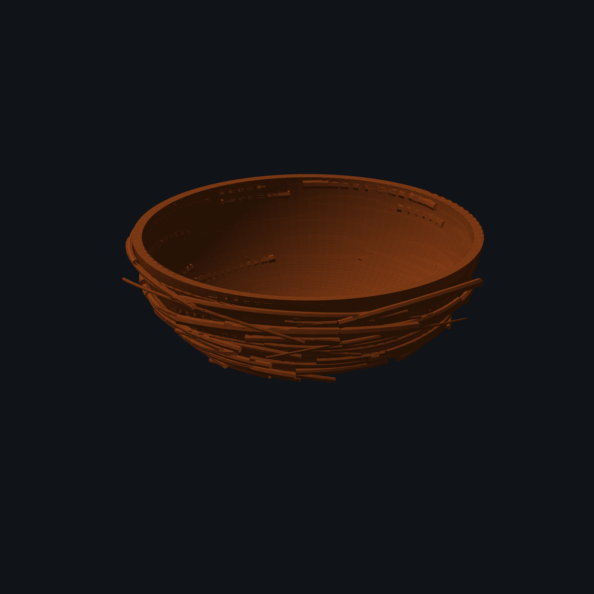
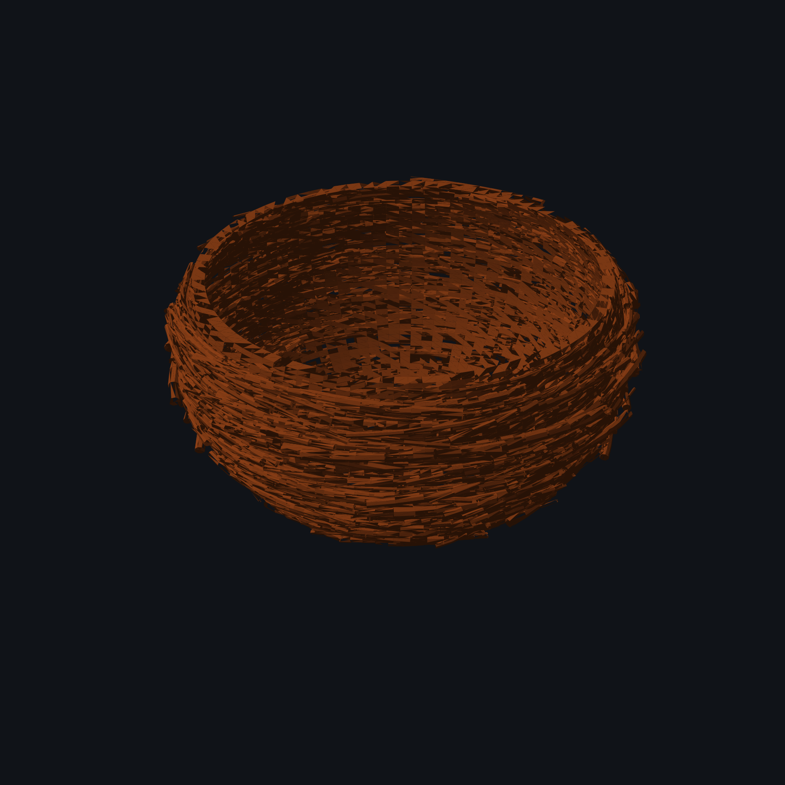
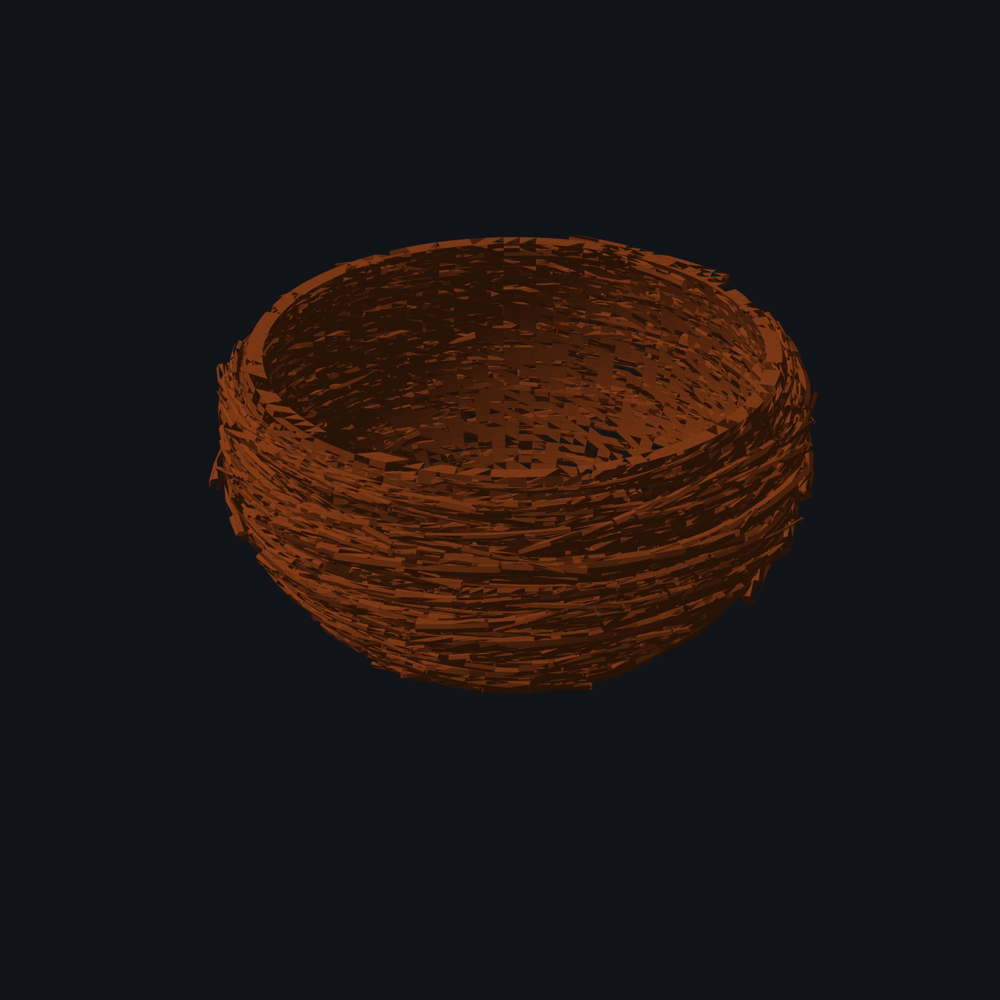

# 3D Nest Generator

This project generates a 3d-printable model of a bird's nest via a Python script. I created it to produce egg storage bowls for the board game Wingspan, but you can use it to create a variety of shapes and sizes that could be used in all sorts of ways.

## Quick start

Install dependencies and run:

```bash
python3 -m pip install -e .
python3 generate_nest.py
```

The output path is controlled by `output.filename` in `config.yaml`.

## Parameters

### `nest`

| Parameter | Description |
|---|---|
| `outer_radius` | Outer sphere radius, in mm. |
| `center_z` | Sphere-center height, in mm. |
| `bottom_z` | Lower outer spherical cut height. |
| `top_z` | Upper cut/rim height. Raise it for a deeper bowl; lower it for a shallower bowl. |
| `wall_thickness` | Outer-to-inner sphere radius difference, in mm. |

The inner radius is `outer_radius - wall_thickness`. Its lower cut is raised by
the wall thickness to create a thicker base.

### `output`

| Parameter | Description |
|---|---|
| `filename` | Output STL path. |
| `resolution` | Angular resolution. Higher values are smoother but create larger files. |
| `remove_bowl_after_sticks` | If `false`, export bowl plus sticks. If `true`, export sticks plus a thick flat base. |
| `bottom_disk_extra_radius` | Extra base radius in mm when the bowl is removed. |

### `sticks`

| Parameter | Description |
|---|---|
| `count` | Number of torus-section sticks. |
| `diameter_min`, `diameter_max` | Stick tube diameter range, in mm. |
| `torus_radius_scale_min`, `torus_radius_scale_max` | Major-radius scale range relative to the bowl. Below `1` selects exterior placement; above `1` selects interior placement. |
| `horizontal_angle_min_deg`, `horizontal_angle_max_deg` | Random stick tilt range. |

Sticks are shifted so their tube touches the bowl wall. Each angular section has
closed end caps. The current output is a collection of intersecting components,
not a boolean-fused single solid.

## Previewing

Open the generated STL in Blender, MeshLab, or a slicer. The generator prints
the bounds, face count, watertightness, and winding consistency after export.
For visual comparisons, save each preset as a separate YAML file, run the
generator, and inspect the resulting STL from the same camera angle in your
mesh viewer.

## Example presets and renderings

These previews use the same high-resolution camera, background, and lighting.
Each rendering is shown beside the configuration changes that produced it.

| Configuration | Rendering |
|---|---|
| **Shallow, lightly textured nest**<br><pre>nest:<br>  outer_radius: 55.0<br>  center_z: 52.92<br>  bottom_z: 5.0<br>  top_z: 45.0<br>  wall_thickness: 4.0<br>sticks:<br>  count: 150<br>  diameter_min: 0.5<br>  diameter_max: 1.8<br>  torus_radius_scale_min: 0.85<br>  torus_radius_scale_max: 1.15</pre> |  |
| **Deep, dense nest**<br><pre>nest:<br>  outer_radius: 65.0<br>  center_z: 60.0<br>  bottom_z: 3.0<br>  top_z: 58.0<br>  wall_thickness: 5.0<br>sticks:<br>  count: 700<br>  diameter_min: 0.4<br>  diameter_max: 2.5<br>  torus_radius_scale_min: 0.55<br>  torus_radius_scale_max: 1.35</pre> |  |
| **Sticks with retained base**<br><pre>output:<br>  remove_bowl_after_sticks: true<br>  bottom_disk_extra_radius: 5.0</pre> |  |

## Limitations

Boolean fusion of sticks into the bowl is not currently performed.

## Use of AI

AI assistance was used as an interactive engineering aid during development.
It helped iterate on the spherical bowl and planar cuts, design and debug the
torus-section sticks, inspect mesh properties, write configuration examples,
and generate preview renderings.

Generated code and suggestions were tested locally and revised based on the
resulting geometry. Users should still inspect generated STLs in their own
mesh viewer or slicer before fabrication.
